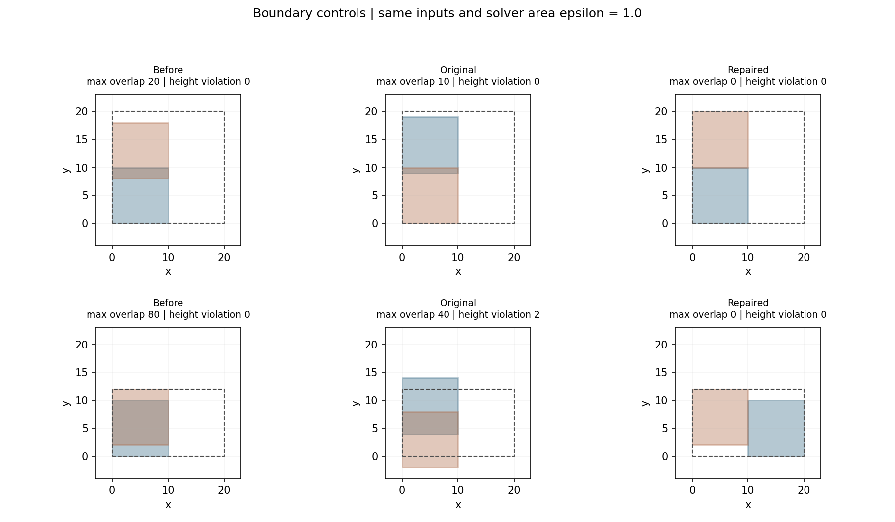

# 第四轮：独立碰撞修复与回滚保护

2026-10-21（北京时间）。新增独立C++修复入口`collision_probe.overlap_repair`。原11个几何控制全部通过，另34项旋转、凹轮廓、非法输入、失败状态与回滚控制全部通过。它修复了上一轮确认的边界和退出问题；原官方源码、扩展、结果及模型权重未覆盖。

后续第七轮新增无横向墙的条带入口，并完成从冻结raw代表开始的三路消融；本文保留第四轮有限参考容器的历史证据。最新结果与精度局限见 [第七轮记录](POSTPROCESS_ABLATION.md)。

## 修复行为

- 每次只平移零件，保留零件数、轮廓及旋转。使用完整轮廓的投影分离候选，对凹形也采用保守的充分分离条件，不再将交集投影宽度当作可靠位移。
- 同时考虑两个方向及条带剩余空间，连续求出两个零件的合法位移分配。高度方向无法容纳时，可选择水平方向。
- 候选必须在边界内，并重新计算所有涉及移动零件的两两交叠，包括第三方零件；仅接受全局交叠总量下降的布局。
- 位移分配只取合法区间内的最小运动解和单方锚定解，避免为降低微小交叠而将两个零件一起搬到容器远端。
- 收敛判断使用移动后的布局。原本在求解器阈值内且在界内的布局原样返回，不再无条件平移到原点。
- 停滞、迭代耗尽、预算耗尽均返回明确失败状态，恢复调用前的全部动作。起始布局越界时返回`infeasible_bounds`并原样保留；该状态不代表已证明此样本全局无可行解。

修正版没有调整Clipper默认精度2、官方有效性面积阈值50或严格诊断容差1e-9。候选分离优先留出原有量化网格的2格（2/128）几何间隙；容器只能容纳恰好接触时，尝试完整投影上的接触分离，并再次核对布局。此为新增位移策略，不是恢复论文算法的声明。

## 同输入控制结果

原11例输入文件哈希与第三轮一致，通过数由4/11变为11/11。求解器默认面积参数0.01和官方调用位置参数1.0分开测试，输入和判据均未放宽。

- 面积参数1.0的边界例：原函数返回后最大交叠10，修正版为0。
- 高度受限例：原函数2000轮后最大交叠40、越界2；修正版1次接受位移后交叠0、越界0。
- 浅交叠0.001低于该例面积参数0.01，修正版按合同原样保留。因此11例通过仍不等于全部严格零交叠；本组严格通过10/11。



[11例完整控制证据](collision_repair/controls.json)记录动作、几何、迭代和状态；[新增34项控制](collision_repair/repair_failures.json)包括16项状态/几何与18项非法输入。后者验证0预算和1步预算耗尽、容器无法容纳当前布局时的停滞、初始越界、反向绕序、37°/90°旋转以及失败原样回滚。非法输入的面积为零自交例不等于完整的任意自交轮廓检测；API使用经过验证的简单轮廓。

## 实际冻结候选的安全回归

在同一16例的已增强候选和原始GT上各调用一次，32次独立进程全部通过安全门禁。最终版本23次原生收敛、9次停滞并原样回滚；安全门禁通过不等于每次调用都修复成功。

- 8个失败代表中，样本46的最大交叠由239.873432降到0.035742，样本47由187.818493降到0.006333，达到本轮求解器面积门槛1.0；其余6个失败代表停滞后恢复原始动作。
- 8个成功回归样本均保留float64参考检查下的最大交叠不超过50；未将该参考检查冒充官方原生评分。16个GT的全部动作保持不变。
- 样本46的包围盒利用率由73.2721%降到50.4322%，仍有明显代价；样本47的72.7985%保持不变。没有通过任意扩宽容器规避边界，参考宽度始终8000，但约束通过仍可能伴随包围盒增长。
- 16个预测都仍未通过1e-9严格零交叠；未进行单独精度修正或float32回写验证。

中间版额外枚举容器边缘位移，虽能消除全部8个代表的明显交叠，却严重降低利用率，未作为最终版本。其完整结果单独保留，最终版收紧位移并对停滞明确回滚。

[安全回归摘要](collision_repair/saved_safety_summary.json)逐例记录输入哈希、原生状态、前后几何、利用率和位移；完整动作与逐次日志仅在私有证据目录。这是“对已增强候选再修复”的安全回归，不是从raw开始的三路消融，也不代表128例总体改善。下一步需在原来的保存候选上完成完整消融，尤其检查压缩能否恢复利用率。

[独立复核摘要](collision_repair/verification.json)重新构建45控制的54组几何及实际回归的96组输入/原生/安全输出几何，另以直接坐标区间核对38组矩形几何；冻结清单、源码和远程结果哈希均匹配。复核确认2例达到门槛、其余6例回滚，以及样本46的利用率代价；没有将报告中已有的通过布尔值当作独立证据。

## 运行与边界

在既有Linux推理环境中从固定官方源码构建，所有输出目录须不存在：

```bash
python build_collision_probe.py --repair --source upstream \
  --output results/collision_round4/repair_build
python check_collision_controls.py --repair \
  --extension results/collision_round4/repair_build \
  --output results/collision_round4/controls
python check_collision_repair_failures.py \
  --extension results/collision_round4/repair_build \
  --output results/collision_round4/failure_controls
python check_collision_saved_cases.py \
  --extension results/collision_round4/repair_build \
  --frozen results/collision_round3/frozen_inputs \
  --output results/collision_round4/saved_safety
```

不传`--repair`仍可构建和调用第三轮原函数探针。新增算法位于`collision_repair.hpp`，通过独立模块绑定使用，尚未接入原全量推理入口。[构建清单](collision_repair/build.json)绑定头文件、扩展、官方源文件及[修复绑定补丁](collision_repair/repair.patch)的哈希。

最多接受2000次位移，候选评估最多100,000次；求解过程使用8秒协作式时间预算，子进程另设10秒超时。时间检查不能抢占单次原生几何运算，输入转换与校验也不属于求解预算，不能将8秒解释为整个API的硬实时保证。失败状态会回滚，局部搜索停滞不证明不存在其他可行排布。

保守投影位移可能增加包围盒、降低利用率；没有保证修复全部8个失败样本。完整的保存候选三路消融、float32回写影响、独立精度修正及128例全量仍需按规划验证。本轮按用户要求仅保留本地代码和记录，不推送GitHub。
