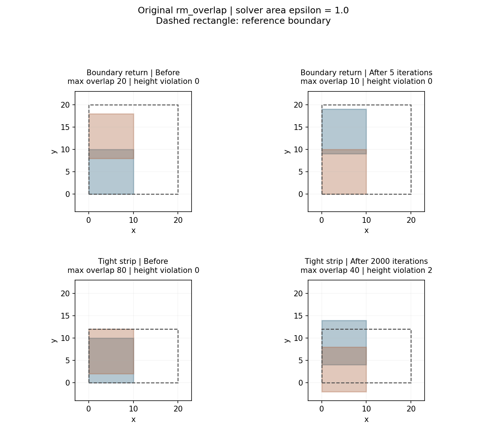

# 第三轮：冻结检查集与验证原碰撞函数

2026-10-21（北京时间）。阶段1完成；阶段2原函数控制未通过，暂不进入16例消融或全量后处理。本轮没有采样、训练、调整权重或修改官方评分阈值。

## 已执行与结论

重新核验官方默认模式的128例基线：457个冻结输入和57,856个输出哈希通过。随后冻结16例同索引候选，在独立源码副本编译原本未启用的`rm_overlap`，运行11个CPU小几何控制，每例独立子进程、10秒超时。

11例程序全部完成，4例通过控制门禁，7例未通过。所有输出均有限、零件数与刚体形状不变；2个高度受限控制新增越界且达到2000轮上限。另5例提前返回后的float64几何仍超过该次求解器面积阈值。原函数不能直接启用后进入全量。

“控制门禁通过”只表示本阶段检查通过，不等于严格零交叠。浅交叠控制仍可残留0.00828125和0.001，低于求解器默认面积阈值0.01，却超过严格面积容差1e-9。

## 冻结材料

- 失败开发样本：25、45、46、47、54、62、99、115；对应候选索引为391、271、224、190、11、347、303、15。
- 成功回归样本：0、17、35、56、74、91、109、127；对应候选索引为88、330、493、321、336、20、460、183。
- 回归选取算法：成功样本按编号排序，取`p_i = i*(120-1)//(8-1)`，排序位置为0、17、34、51、68、85、102、119，包含首尾。
- 每例保留原始/增强的同索引候选、原始/增强GT、轮廓、原指标及哈希。失败候选依原策略按阈值化交叠最小、利用率最高选取，不宣称它是精确交叠最小者。

[冻结清单](collision_validation/manifest.json)绑定基线计划、汇总、校验、诊断和16个case的哈希。清单SHA256为`9b0fd899a72e29027906751fe9caf4386f760eddf3d17124a5b9fe49732090c6`。原始预测、轮廓和完整冻结case保存在私有证据目录，不重新分发数据；该开发/回归集不作为独立泛化证据。

## 两个可复查反例

以下均为边长10的两个同向正方形，采用官方Python调用位置实际传入的求解器面积参数`1.0`。该参数先前因碰撞调用被注释而没有生效，与官方有效性阈值50不同。

1. **边界回拉后带交叠退出。** A在`(0,0)`，B在`(0,8)`，参考宽高20×20。初始最大交叠20，函数第5轮提前返回后仍为10，超过求解器面积参数1。返回条件检查的是边界移动前的碰撞标志。
2. **高度受限时迭代耗尽并新增越界。** A在`(0,0)`，B在`(0,2)`，参考宽高20×12。初始均在界内，横向并排存在可行解；2000轮后残余交叠40，最大高度14、负坐标达到-2，新增高度越界2。原函数返回`void`，原调用方无法区分耗尽与正常结束。



另用默认求解器面积阈值0.01验证单位方形：下边界例提前返回后残余0.1015625；高度受限例耗尽后残余0.39375、越界0.203125。明显交叠和凹多边形控制也存在提前返回后的残余。完整输入、动作、前后几何、迭代与逐项门禁见 [11例控制证据](collision_validation/controls.json)。这些小例子的面积单位和官方数据不同，不能将控制通过率当作128例修复率。

## 源码审查与独立构建

固定官方提交`ff75815e24ec50cd7fa8b2abdec1acfe0b55be95`。相关行号对应`external/rmspacing_cpp/main.cpp`：

- 578行固定2000轮，循环耗尽后没有返回失败状态。
- 609–650行使用移动前的布局判交；664–678行计算边界回拉；685–701行更新布局；707–719行只看旧`inserted`，未重新检查碰撞或使用`inbox`。
- 506–526行由交集投影选择有向位移；613–633行虽然计算中心和投影差却未用于定向，638行固定选择同一个分支。对非凸多边形，交集判定可用不等于该位移保证分离。
- Clipper默认精度量化及压缩误差仍是独立问题。本轮未改精度、eps或位移策略。

独立扩展名为`collision_probe`，只添加返回actions的绑定、线程局部迭代计数与返回路径标志；不修改原位移、阈值或退出逻辑。使用g++10.5、Python3.11.15、`-std=c++17 -O3 -fPIC -fopenmp`。原官方源码、原扩展及基线均保留。

[构建清单](collision_validation/build.json)记录源码和扩展哈希；[插桩补丁](collision_validation/instrumentation.patch)可逐项检查。控制脚本核对实际加载扩展的路径与SHA256，防止误加载其他版本。原生工作进程的返回路径只供诊断，不直接作为成功判据。

[本地复核摘要](collision_validation/verification.json)：16例文件及64组几何匹配基线诊断，最大绝对差约1.59e-12；11控制的22组几何复算一致，9个方形另用直接坐标区间法核对。服务器与本地证据和脚本哈希一致。这验证记录一致性，不改变控制门禁未通过的结论。

## 重跑方式

假设已有完成且校验的官方默认模式结果和对应诊断，环境中有CPU可用的PyTorch、Shapely、pybind11和C++编译器。下面所有输出目录必须不存在；脚本与`diagnose_results.py`、`run_benchmark.py`在同一目录。

```bash
python freeze_collision_inputs.py \
  --results results/validation_upstream_mode \
  --diagnosis results/diagnosis_upstream_mode \
  --output results/collision_round3/frozen_inputs
python build_collision_probe.py --source upstream \
  --output results/collision_round3/probe_build
python check_collision_controls.py \
  --extension results/collision_round3/probe_build \
  --output results/collision_round3/controls
```

`controls.json`的`gate_pass=false`是实验未通过；控制脚本本身可以正常退出。应同时读取逐例`status`、`checks`和最终`gate_pass`。门禁包含规划的形状、有限性、边界与交叠不恶化检查，并额外独立检查函数是否在2000轮内返回、返回布局是否满足该次求解器自己的面积阈值。官方有效性50和严格诊断1e-9均未调整。

下一轮先在独立副本处理位移接受、边界更新后重新判交、耗尽状态与回滚；优先让上述反例通过，再重跑其余控制。阶段2通过后，才对已冻结16例做保存候选消融。本轮没有测量16例修复数，也没有改进120/128基线的证据。
