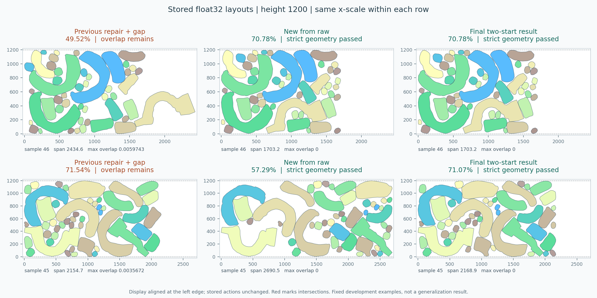

# 第八轮：保留凹形嵌合的修复与紧凑化

图中样本46已从旧修复后压缩的49.5191%提高到70.7833%，真正写出的float32动作通过严格几何及高度检查。固定16例预测全部严格可行，平均条带利用率72.6870%；16个GT也全部保持严格可行。这里仍是参与过开发的16个代表，不是128例全量结果或独立泛化证据。

## 官方更新核查

2026-10-24从官方API读取提交和全部11个issue/PR条目，并以 `git ls-remote` 交叉核对。主分支仍为固定版本 `ff75815e24ec50cd7fa8b2abdec1acfe0b55be95`；最后提交是2026-10-13的 [拼图生成器重试/切分修正](https://github.com/TimHsue/GFPack-pp/commit/ff75815e24ec50cd7fa8b2abdec1acfe0b55be95)，不是新的排布或消碰撞算法。issue/PR最近更新时间为10月14日，没有10月21日后可直接采用的修复。网页缓存曾漏掉10月提交，结论使用新API及Git远端引用。见 [核查记录](compact_layout/upstream_update.json)。

## 大空隙的原因与改法

旧独立修复器用完整轮廓的投影计算分离位移，对凹多边形过于保守；其目标主要减少交叠，未直接优化跨度。样本46只接受2步，就把一个大凹件移动约929.52个单位，另一件移动约280.89，最终利用率降为48.0002%。原压缩仅恢复到49.5191%。用户图中72.77%的“仅压缩”布局仍有最大交叠约239.87，不能作为严格可行的目标成绩。

新实现是独立的工程后处理方案：

- 使用[约束三角剖分](https://shapely.readthedocs.io/en/2.1.2/reference/shapely.constrained_delaunay_triangles.html)保留凹口，计算沿给定方向连续的禁止平移区间；没有把整个轮廓当凸包。区间给出候选，最终接受仍由完整真实轮廓逐对交叠检查决定。
- 优先短距离移动单件，代价含跨度增长惩罚。搜索按16/64/256/1024/4096半径逐级，在首个找到候选的半径内比较；这是局部贪心，不是全局最短位移。修复后交替向左/右做4遍水平紧凑化，每个接受点都严格可行，跨度不增加。
- 所有动作先单次转float32，旋转之后固定；每个新平移也先转float32再验证。依据最终旋转求每件可表示的合法y区间，必要的边界移动显式记录并重新判交。高度1200、面积50和严格1e-9容差均不放宽，没有8000右墙。
- 单件移动也会受邻件包围而局部受困。统一比较两个起点：同一raw候选，以及该候选的第七轮协同修复结果；两者经同一新处理后，只在严格可行端点中选水平跨度最小者，等宽选raw。预测的第二起点始终来自同一预测，不使用GT或新采样。

原raw单起点全部严格可行、平均71.8258%，但样本45因局部受困仅57.2911%。保留这一失败代价，并用统一双起点恢复到71.0681%，没有针对例号硬编码。32个输入中21个存储起点相同，明确复用；其余11个额外运行。预测中45、74选择旧修复起点，其余14个选择raw；GT均等宽选择raw。

## 固定输入的结果

沿用清单SHA256 `9b0fd899a72e29027906751fe9caf4386f760eddf3d17124a5b9fe49732090c6`，8失败开发例、8成功回归例，每例1个既定候选及其原始GT。候选索引此前按增强结果选定，所有16例已用于开发。没有训练、重新采样、改模型/权重或改官方源码。旧结果只读绑定，新文件独立保存。

- 最终预测：面积50+条带及严格检查均16/16，参考最大/总交叠和高度越界均为0；历史失败组8/8修复，成功组8/8保留有效。旧修复后压缩为面积50+条带14/16、严格0/16。
- 全部16例、失败计零利用率：旧组合58.8765%→新72.6870%。新方案全部有效，因此条件均值同为72.6870%。旧组合仅有效14例的条件均值67.2874%，不能混用分母。
- raw新修复单独平均69.7561%，加水平紧凑化后71.8258%，双起点后72.6870%。GT仅修复70.9147%，紧凑化后72.6720%，严格仍16/16；旧官方压缩的GT利用率72.8279%，但全部产生微小交叠。
- 样本46：旧组合49.5191%→新70.7833%，跨度2434.64→1703.24，零件没有再被远推到外侧。样本47、62、99也有明显改善。旧失败54、115现在严格可行，利用率分别61.4117%、75.8539%。
- 仍有代价：45、74、91、109相比旧组合面积50有效结果略降，分别约0.47、0.44、0.74、0.81个百分点；换取了严格无交叠。54旧非法布局的利用率更高，也保留其数值，不把非法布局计为成功收益。



每行横向尺度一致，仅为展示将各布局左边缘对齐，不改变存储动作。第二行展示单起点明显退化及双起点恢复，避免只展示收益。微交叠肉眼可能不可见，以标注和几何复核为准。

## 复核、预算与局限

12项顶层紧凑化检查通过，其中包含12个指标fixture、10个平移区间fixture及1024个随机平移对照；另有7项双起点选择检查通过。这些分组有包含关系，不累加成独立控制总数。检查覆盖凹口嵌套、已知方块空隙、满高件、负x/超过8000、25/45真实float32越界、非法高利用率候选拒绝、零预算和全失败分母。

[单起点独立复核](compact_layout/verification.json)检查96个新阶段、192个旧双精度基线、8565条移动记录及402555次移动件配对重测；其中832条存储后为零位移，8500条为紧凑化终点，不能把移动次数等同于有效改进。[双起点独立复核](compact_layout/portfolio_verification.json)另外重放所有新增非重复起点、检查同源候选及严格选优。验证器使用独立的仿射轮廓变换和struct float32重建，不调用优化器/区间模块，也不重新求解。

本轮在本地CPU运行，Python3.13.5、NumPy2.4.3、Shapely2.1.2、GEOS3.13.1；旧服务器为Shapely2.0.7，新旧存储动作均用当前参考几何重新量测。没有在Windows加载旧Linux `calutil.so`，所以新结果是参考几何有效性，不冒充新一轮官方原生calutil重放。旧原生向量和195份输出哈希保留。

两个不同起点的新求解时间计入后，32输入均值约4.784秒、最大15.378秒，**不含此前旧修复起点的生成成本**。每次新尝试有45秒协作预算和96次修复上限，固定4遍压缩；不是物理搬运路径规划，允许直接跳至无交叠终态。没有保证全局最优，也不保证对其它输入无利用率退化。尚未把这个秒级后处理应用到每例512候选或128例全集。

当前已修复这批输入的精度与明显空隙问题；下一步可以冻结128例既定候选做一次同源对照，同时记录严格有效性、失败计零和运行成本。论文模型规模、真实训练配置及未公开约束差异仍单列，不能据此称论文完整复现。

## 复跑入口

在独立环境安装 `requirements_compaction.txt`，不升级原推理环境。需原冻结清单及第七轮完整私有动作/日志作为输入；本仓库仅分发代码、指标和哈希。以下输出目录/文件必须不存在：

```bash
python check_compact_controls.py --frozen FROZEN16 --previous-results ROUND7_ABLATION --output NEW_CONTROLS.json
python run_compact_layouts.py --frozen FROZEN16 --round7 ROUND7_ABLATION --output NEW_RAW_RESULTS
python check_compact_portfolio.py --frozen FROZEN16 --previous-results ROUND7_ABLATION --raw-results NEW_RAW_RESULTS --output NEW_SELECTION_CONTROLS.json
python run_compact_portfolio.py --frozen FROZEN16 --round7 ROUND7_ABLATION --raw-results NEW_RAW_RESULTS --output NEW_PORTFOLIO
python verify_compact_layouts.py --frozen FROZEN16 --round7 ROUND7_ABLATION --results NEW_RAW_RESULTS --output NEW_VERIFICATION.json
python verify_compact_portfolio.py --frozen FROZEN16 --round7 ROUND7_ABLATION --raw-results NEW_RAW_RESULTS --portfolio NEW_PORTFOLIO --output NEW_PORTFOLIO_VERIFICATION.json
```

在线使用可调用 `compact_portfolio.optimize_two_starts(polygons, ids, raw_actions, repair_seed)`；`repair_seed`应由第七轮 `overlap_repair_strip` 对同一raw按固定参数1.0/2000生成，不得用另一个候选或GT替代。代码会检查存储旋转一致；上游调用者仍负责同候选来源，批量入口有完整哈希及原始动作核对。
