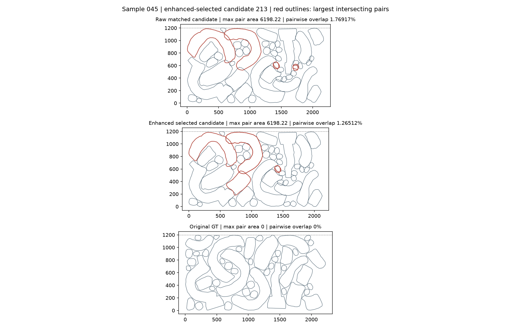
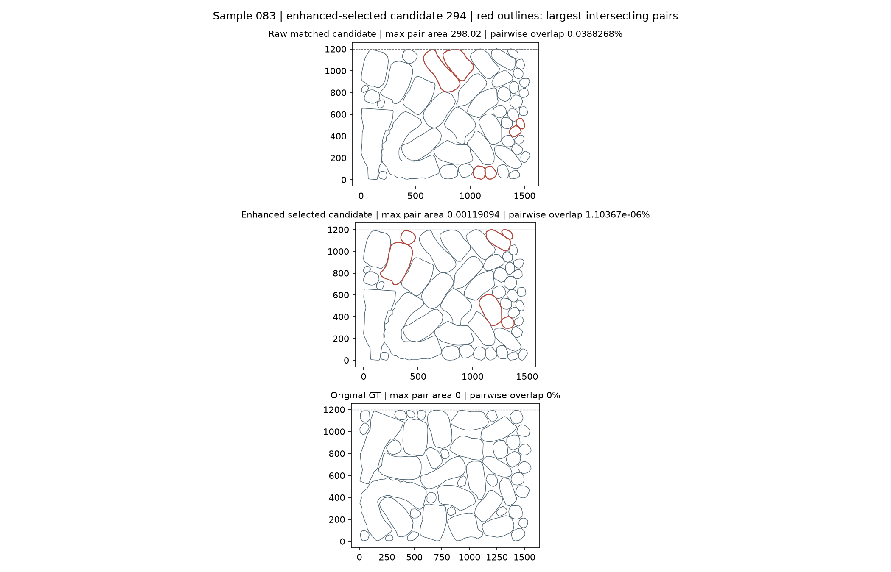

# 首轮基线诊断与下一步修正

首部分诊断对象为128例 **eval 模式基线**；后文记录已完成的官方默认模式对照。第三轮已独立验证原碰撞函数，发现边界和退出缺陷，见 [碰撞控制验证](COLLISION_VALIDATION.md)。没有训练或修改权重。

## 结论：先修正推理模式的可比性，再讨论训练

首轮入口主动调用 `model.eval()`，而固定版本的官方入口没有切换模型模式。显式关闭 dropout 是我们引入的差异，不能将首轮成绩直接视为官方入口成绩。

三个固定样本用同一权重、seed3407、512候选、128步成对运行，两种模式都在 `torch.no_grad()` 下执行，没有优化器或反向传播。增强后官方有效候选数如下：

- 样本0：eval 为11/512，官方默认模式为32/512。
- 样本45：两种模式均为0/512。
- 样本77：eval 为0/512，官方默认模式为149/512。

这是特意选取的三个诊断样本，不能外推整体提升，也没有隔离 dropout 改变随机数序列与PyTorch执行路径的各自影响。同种子并不保证逐位重现：样本0此前完整基线为9/512，本次独立eval对照为11/512，不能覆盖旧结果。

对照证据：[模式检查](diagnosis/mode_comparison.json)。[官方入口固定版本](https://github.com/TimHsue/GFPack-pp/blob/ff75815e24ec50cd7fa8b2abdec1acfe0b55be95/src/evaluate.py#L397) 在DDP包装后进入采样，未调用 `eval()`。

## 严格零交叠失败包含不同量级的问题

重新读取已保存的候选、原始GT和增强GT，使用float64坐标变换与Shapely复算，未重采样。

- 原始GT：128/128例通过1e-9面积容差的严格零交叠；增强后的GT：0/128通过，最大两两交叠面积的中位数0.005473、范围0.001320–0.166069。增强GT的两两交叠面积之和占总多边形面积的比例中位数仅0.00000214%。这些微小残余与明显穿插应分开看待。
- 78例存在官方有效候选：选中最佳有效候选的最大两两交叠面积中位数0.038476；其中40例不超过0.1，但也有36例超过1。不能把这一组都称为纯数值噪声。
- 50例没有官方有效候选：按官方记录的阈值化交叠率最小、利用率最高的顺序选候选，其最大两两交叠面积范围62.722574–6198.221659，中位数696.379280，存在明显几何冲突。

失败样本的上述选择不是“精确交叠面积最小”的保证；官方交叠记录会忽略面积不超过50的交叠。此前无有效候选时展示的候选0只是回退预览，本诊断没有拿它冒充最佳失败候选。

面积均为官方坐标缩放后的平方单位，不是毫米等物理单位。两两交叠求和可能重复计算多重交叠区域。完整记录见 [128例几何复查](diagnosis/diagnosis.json)。

## 公开实现中的数值精度和增强边界

[官方C++调用](https://github.com/TimHsue/GFPack-pp/blob/ff75815e24ec50cd7fa8b2abdec1acfe0b55be95/external/rmspacing_cpp/main.cpp#L742) 中，`rm_overlap` 被注释，实际执行 `workx/worky` 缝隙压缩；宽高参数没有在这些调用中作为容器约束使用。[采样器](https://github.com/TimHsue/GFPack-pp/blob/ff75815e24ec50cd7fa8b2abdec1acfe0b55be95/src/sde.py#L115) 的128步循环也未调用论文描述的碰撞约束梯度。

[论文5.2和补充S2](https://arxiv.org/html/2406.07579v2#S5.SS2) 将碰撞约束与缝隙压缩共同作为增强。公开快照与论文的这处差异，支持先检查约束实现，不支持直接得出“必须重新训练”。

精度方面，[Intersect默认参数](https://github.com/TimHsue/GFPack-pp/blob/ff75815e24ec50cd7fa8b2abdec1acfe0b55be95/external/rmspacing_cpp/clipper.h#L79) 为2，当前 [ClipperD缩放](https://github.com/TimHsue/GFPack-pp/blob/ff75815e24ec50cd7fa8b2abdec1acfe0b55be95/external/rmspacing_cpp/clipper.engine.h#L531) 对应128倍整数网格，即坐标步长1/128=0.0078125；压缩搜索却使用0.001停止精度。真实扩展的方形对照表明：参考交叠0.001时原生返回0；参考交叠0.01时原生返回0.0078125。见 [最小精度对照](diagnosis/precision_probe.json)。

这证明原生“无交叠”与高精度严格检查不是同一判据；GT前后对照支持数值量化参与了微小残余，但没有证明每个残余都只由量化造成。最初诊断脚本错误要求原生0.01结果与参考值相等，断言失败后改为独立验证接触/正交叠控制，未修改任何评测阈值。

另外，官方有效性只检查阈值化交叠，不检查固定容器边界。78例选中有效候选中，71例落在参考8000×1200范围内，77例落在入口使用的8000×1205范围内。8000宽度来自入口参考，不是条带问题的理论宽度上限；这里只把它作为诊断参考。

## 仍未对齐的论文设置

[论文5.2](https://arxiv.org/html/2406.07579v2#S5.SS2) 使用sigma_min=0.1、旋转分量尺度1000和高斯初始化；当前源码使用1、500和均匀初始化。训练代码也使用500，所以不能仅按论文数字修改推理尺度，现有权重是否匹配论文所有设置仍未知。

本文评测的是发布包中的128例验证集，尚未确认与论文新生成测试集完全相同。论文的候选可行率、当前“至少有一个有效候选的样本数”以及有效样本条件均值，分母不同；74.96%的条件均值不能直接宣称接近论文成绩。

## 代表样本与已执行的下一步

样本45：按官方交叠记录选出的失败代表，增强仍保留明显穿插。红线标出最大交叠对的轮廓，不表示红色多边形的全部面积都重叠。

样本83：增强把明显交叠降到微小残余，但严格零交叠仍失败。

上述首轮诊断后执行了独立的官方默认模型模式128例对照，已完成校验和几何复查，结果见下节。原eval基线和原始文件保留。后续按碰撞控制与精度修正的阶段条件推进，仍未启用生产路径上的碰撞算法。

## 第二轮剩余8例失败定位

官方默认模式全量评测已完成并校验通过：128例程序成功，120例有官方有效候选，8例没有；有效样本平均最佳利用率76.80%，全部128例无有效候选计零为72.00%。

剩余样本为25、45、46、47、54、62、99、115。对各自按官方阈值化交叠率选出的代表候选，精确几何复查均发现1–3对面积超过50的交叠，最大单对交叠为84.56–554.06平方坐标单位。它们均在参考8000×1200范围内，原始GT均无交叠，因此这些代表失败不是越界或该样本本身无可行布局。

直接失败原因是采样留下的局部碰撞未被当前增强消除。8个代表中4个的最大碰撞对在增强前后保持相同，面积变化不超过0.02。样本45同一对由554.052变为554.058，说明压缩没有解决这对碰撞。当前`rm_spacing_all`关闭了`rm_overlap`，只执行交替x/y缝隙压缩，不能当作完整去碰撞器。

这解释保存结果为什么不合格，但尚未通过启用去碰撞的消融试验证明全部8例都能修复；也未穷举寻找每例精确交叠最小的候选。512个候选中没有官方有效解，是本次随机采样结果，不代表模型永远无法解决这些样本。

微小交叠另有精度问题：第二轮120个选中有效候选中80例最大交叠不超过0.1；原始GT严格通过128例，增强GT严格通过0例。已完成的方形控制证明原生Clipper量化可漏掉小交叠，但不能据此把所有小交叠都归为单一原因。

下一步应在独立构建中验证碰撞消解，再以保存候选做前后对照，分别检查官方有效性、float64交叠、条带高度与利用率，保留原始基线；不应通过放宽阈值“修复”结果，暂不需要据此启动从头训练。
