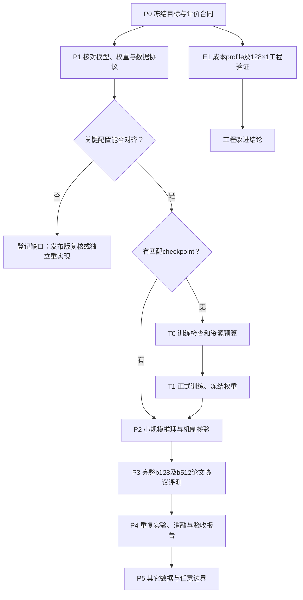

# GFPack++论文复现路线

规划日期：2026-10-26。工程算法冻结点：`6e1338d`；官方源码：`ff75815e24ec50cd7fa8b2abdec1acfe0b55be95`。本轮只制定路线，没有启动新评测、训练或对外联系。

2026-10-28状态更新：独立分支 `codex/paper-reproduction` 已建立，最新执行状态见 [完整复现进度](FULL_PAPER_REPRODUCTION.md)。下文E1的128×1工程验证已完成，结果见 [验证报告](ENGINEERING_TRANSFER_128.md)；P0评价合同已建立[草案](../configs/paper_reproduction/evaluation_contract.json)，方法配置、重复种子和硬件等仍待实际固定。下文保留原规划，涉及“待做128×1”的内容不再作为新待办。

## 目标与已有基础

首个目标为**支持任意旋转的Dental主实验复现**，之后扩展训练消融和其它任务。完成Dental时只称“Dental主实验复现”，不直接称整篇论文复现。

已完成：发布实现的128例基线中120例至少有一个官方有效候选；新工程后处理在16个开发代表上严格有效16/16、平均条带利用率72.6870%，GT16/16保持严格有效。前者是样本成功数，后者来自开发代表，均不能直接替代论文候选可行率。依据见 [权重审计](CHECKPOINT_ALIGNMENT.md)、[推理重建](PAPER_ALIGNMENT.md)、[工程改进](COMPACT_LAYOUT.md)。

论文目标参考：Dental每例48件、高1200的水平条带。主表增强后，`b=128`利用率Min/Avg/Max为70.57/75.21/78.67%，时间4.28秒；`b=512`为74.06/77.53/79.79%，时间14.5秒。旋转Dental的平均批内候选可行率为96.3%；Table 2没有重新列明该百分比的具体batch分母，正式对照前仍需固定对应协议。见 [论文§5–6、Tables 1–2](https://arxiv.org/html/2406.07579v2#S5)。

论文表格的0.00%交叠是显示精度，本项目1e-9是额外诊断口径；14.5秒也不是当前硬件的承诺。模型、数据、方法、指标都应可比，数值接近只是验收的一部分。

## 总体依赖

P1与E1并行。工程验证成功不会补齐模型/协议缺口；新工程算法的全候选成绩也不自动成为论文原方法成绩。

## P0：固定协议与验收合同

- 以已审计的arXiv v2为操作规格，保留ICCV主文/补充材料版本和哈希，差异逐项记录。
- 将`engineering_transfer_128x1`与`paper_dental_b128/b512`分开编号。65536是本项目128×512的计划分母，不反推为作者公布了精确可行整数。
- 固定数据、权重、代码、候选索引、环境、随机种子、推理模式和选择器。现用测试与官方Dental test同字节已证实；它是否等于主表原始划分仍待确认。
- 利用率采用固定条带面积：零件面积和/(1200×水平跨度)，另保留原生包围盒口径。对不同可行判据分别选择最佳候选，不能仅检查一个原生最佳候选后就推断整批没有严格解。
- 分开报告候选有效率、样本至少一解率、最佳可行利用率Min/Avg/Max、条件均值、全部样本失败计零均值、交叠、越界、执行失败和时间。
- 原生判据按实际扩展输出与float32转换重放；参考面积50+条带、严格1e-9、存储精度分别报告。论文未知项明确标注，不能以源码默认补写为论文事实。
- 正式运行前约定重复种子数、比较容差、失败/超时分母与停止规则；未约定容差时只报告差值，不事后选容差盖“达标”章。

**通过条件**：候选规模、分母与选择器无歧义，逐候选记录可独立重建指标，未知项与假设有标签。

**待产物**：`evaluation_contract.json`、资源/运行清单、选择规则、目标清单。本轮未生成虚假的已执行记录。

## P1：模型、权重及数据材料关卡

现有权重10,621,276元素，与论文补充材料约40M描述的对应关系尚未解释。不能仅扩到40M，也不能认为改变推理噪声或旋转比例就匹配了训练。

需要补齐：实际模型构造及边界输入、匹配checkpoint与EMA/dropout行为、checkpoint真实训练配置和日志、论文测试实例清单、非凸分离位移及增强的步长/顺序/停止精度。检查切分粒度是实例、零件组合还是动作；共享Dental基础轮廓本身不简单等同数据泄漏。

复用现有公开历史、补充包和作者回复，建立“论文值/源码默认/本次实际值/权重可证明值/未知”清单。源码默认1205高度、1/500尺度与本项目明确覆盖为1200的实际运行分开记录，不能把默认值误写为历史实参。

公开材料不足时整理作者问题清单和所需文件名；本规划不发送issue或邮件。无新信息时不重复整库搜寻。

**通过及失败分支**：材料和匹配权重齐备，进入P2；架构、配置、数据已固定但无匹配权重，进入T0/T1；关键材料仍缺失，登记未完成项，交付发布版复核或明确假设的独立重实现。工程优化不用于填补论文模型证据。

**待产物**：带来源的配置差异清单、checkpoint兼容性、数据切分说明、缺口/假设清单。

## E1：并行完成128×1工程验证

先profile完整成本，覆盖未按新算法结果筛选的不同碰撞程度与顶点数；分别计时旧修复起点生成、新求解、I/O和独立复核，测内存、并发吞吐与超时。第八轮4.784秒均值含GT和挑选输入，漏计旧起点生成，不能直接用作全候选预算；机械乘65536约87小时串行墙钟时间，仅提示先量测的必要，不是实际工期预测。

冻结128×1代表：延续16例既定索引，其余按运行新算法前写定的旧基线规则选择，并记录这两部分的选择过程。16例标开发集，其余112例标迁移回归，不能称完全独立随机测试。

固定`6e1338d`及依赖，不重新采样、不在验收中途调参。比较同一候选的新旧结果、真正写出的float32动作、GT、严格/面积50有效性、宽度、利用率、所有退化与成本。Windows参考几何和原Linux原生重放分开；未执行的检查明确标缺测。

**通过条件**：128槽位完整，原资源未改，独立复核通过，失败与退化可解释。不能删失败或不断调验收样本追求100%；发现缺陷时保留本次结果后另立版本，再跑同一128例不再是新的独立确认。

**待产物**：128×1冻结清单、逐例对照、GT/存储回归、修复/退化名单、profile与报告。新工程算法的128×512是另一个需预算的实验；top-k裁剪、缓存或近似若改变流程，另行编号，不外推96.3%。

## P2：小规模机制核验

使用与目标模型匹配的配置，核查噪声/先验、时间网格、旋转表示、约束符号/权重与增强停止规则，每次只改一个待验证因素。既有三配置探针保留为联合变更探针，不称单因素消融。

验证随机状态、dropout、填充、batch与同seed行为；跨平台不保证噪声逐位一致，在固定环境保存真实输入/噪声哈希，不放宽哈希检查。GT只做控制与评价，不向预测提供另一份解。

**通过条件及产物**：权重与架构完整兼容，输出有限，公式和边界控制通过，实现假设显式登记；交付控制报告、采样/增强配置及复跑命令。失败时回到具体因素，不直接扩大运行。

## T0/T1：确需训练时再开展

真实配置和数据切分固定后，先做8–32个训练样本的短过拟合及checkpoint保存/恢复测试，验证DSM与利用率加权有学习信号；这不是泛化结果，加权统计只从训练集计算。

测目标硬件吞吐、显存、读数和验证成本后，再约定更新次数、停止标准、GPU预算与失败退出条件。论文训练服务器/时间描述不能直接换算A800工期。存在匹配作者权重时，可先复现推理主结果，再单独复现训练过程。

**待产物**：配置、数据切分哈希、学习曲线、资源估算、checkpoint和恢复记录。只有参数规模接近的随机模型不进入论文验收；正式训练另立可审阅方案，本轮不启动。

## P3：完整论文协议评测

按固定配置先做完整`b=128`，再做`b=512`。若采用128测试实例，计划分母分别为16384和65536；失败、超时与缺失仍留在计划分母。

主结果使用目标论文机制，第八轮工程后处理另列报告。逐候选保留raw与论文增强后的几何/状态，在相同可行判据下每例选最好者，再跨实例统计；保留增强前后和所有失败。

计时拆成准备、采样、增强、选择、几何评价与I/O，记录预热、GPU同步和硬件。硬件/时间边界未对齐时只报告差异，不漏掉CPU后处理后声称端到端更快。

**通过条件及产物**：P1差异已解决或按重实现明确声明，完整覆盖与独立复核通过，按预注册合同报告目标差值、重复波动、几何和成本。利用率达到某个数字而候选率、可行性或方法不匹配，不宣布论文复现成功。交付Dental主表、逐候选指标、失败分析、耗时、图与重放清单。

## P4/P5：消融、扩展及交付

固定训练/测试协议，逐项比较约束、增强、利用率加权、几何和关系编码。网络/损失消融需要匹配训练，不能只切换推理开关替代。重复次数在看到结果前约定。

Dental主结果完成后扩展Garment、Puzzle方形、任意边界、Atlas和零件数量变化；任意边界需对应网络输入和数据，不用条带后处理替代。最终分别标注发布版复核、工程改进、Dental主实验、训练复现及其它任务的完成状态。

## 近期执行单与工期

1. 先建立P0指标合同及分阶段完成清单，锁定Dental范围。
2. 同期整理P1已有证据及缺口；作者问题清单只准备，不自动发送。
3. profile完整后处理成本，再固定128×1清单并运行工程迁移回归。
4. P1材料齐备后按权重分支：有匹配权重直接P2；无匹配权重先T0/T1，再P2；机制核验通过后进入P3全量评测。

文档核查约半个工作日；profile和128×1入口完善预计1–2个工程工作日。实际评测时长在量测吞吐后填写。外部材料响应、正式训练工期与最终达标概率目前不可估。优先解决模型和验收协议，避免全部时间继续投入开发样本优化。

## 来源

- [论文v2及补充章节](https://arxiv.org/html/2406.07579v2)：目标、方法和指标定义。
- [ICCV原始补充包](https://openaccess.thecvf.com/content/ICCV2025/supplemental/Xue_GFPack_Attention-Driven_Gradient_ICCV_2025_supplemental.zip)：已保存哈希的模型/训练描述。
- [官方固定版本](https://github.com/TimHsue/GFPack-pp/tree/ff75815e24ec50cd7fa8b2abdec1acfe0b55be95)：源码事实，不反推权重训练历史。
- [作者对validation/test的说明](https://github.com/TimHsue/GFPack-pp/issues/7#issuecomment-4441702715)、[边界输入说明](https://github.com/TimHsue/GFPack-pp/issues/9#issuecomment-6150885031)：资料范围和缺口。
