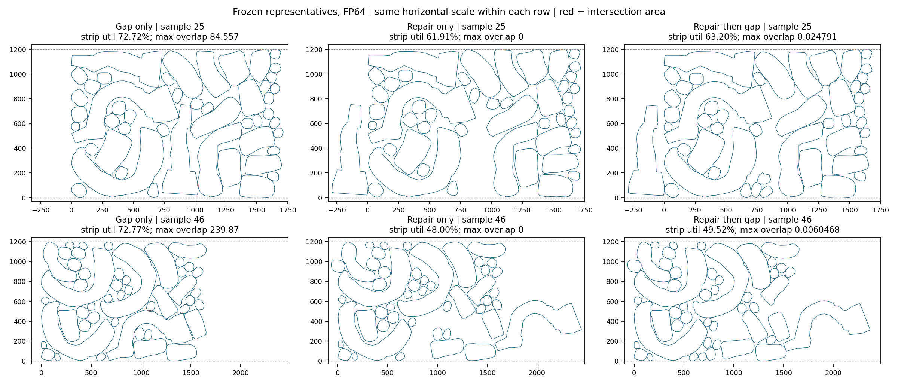

# 第七轮：冻结16例的三路后处理消融

三路消融已完成：96次隔离CPU调用、192份双精度输出，无执行失败，约109.66秒。组合路径修复了6/8个失败代表的面积50有效性，并保持历史成功组8/8有效；但压缩重新引入微小交叠，float32回写也有边界退化。当前进入精度修复阶段，尚不启动128例全量。

## 固定输入与公平比较

继续使用第三轮冻结清单，SHA256为 `9b0fd899a72e29027906751fe9caf4386f760eddf3d17124a5b9fe49732090c6`。失败开发组为25、45、46、47、54、62、99、115；成功回归组为0、17、35、56、74、91、109、127。每例只有**一个既定候选及其原始GT**，不是重新评估每例512候选，也不代表128例总体有效率。

预测严格从 `raw_actions` 开始，GT从 `gt_actions` 开始。原始候选索引由此前增强结果选定，这种选择已经参与开发，不能包装成独立验证。所有输入原本在高度1200内，因此不加原点归一化、边界裁剪或重新选择候选。历史官方入口会先将预测XY减包围盒原点，本轮保持冻结raw原样，不能与旧增强结果宣称逐位相同。

三条路径分别为：官方仅压缩；独立修复；独立修复后再官方压缩。一次官方 `rm_spacing_all` 的实际顺序是 **x/y/x/y/x五遍**，本轮完整保留，不以只有x/y的另一个函数替代。压缩调用仍传原API所需width8000，但该函数没有使用此宽度；本轮修复和参考评价都没有横向墙。

本轮新增 `overlap_repair_strip`，仅约束y位于[0,1200]。旧有限容器API和默认行为保留，并回归原45控制。求解面积参数1.0、最多2000次接受位移/100,000次候选评估、8秒协作预算，外部worker限时15秒。Clipper精度2不变，数值坐标范围检查不是容器边界。修复失败仍按原合同恢复调用前输入；**没有额外安全guard将压缩恶化结果偷偷回滚**。

最终float64动作只转换一次到float32，保留两份输出及两种几何。所有零件数、轮廓及旋转分量保持不变；不存在训练、扩散采样或权重更新。原官方源码、旧扩展和所有历史结果保留。

## 三路实际结果

以下“有效”使用float64参考几何最大两两交叠面积≤50，并位于高度1200条带；“严格”沿用本项目1e-9交叠/边界容差，不是论文宣称的精度标准。初始raw代表有效5/16、严格0/16；GT严格16/16。

- **仅压缩**：预测有效8/16、严格0/16；失败组0/8，成功组8/8。float32回写后计数相同。16个GT均保留面积50有效，但严格16/16降为0/16。
- **仅修复**：预测有效13/16、严格9/16；失败组有效6/8，成功组7/8。float32回写后有效11/16、严格8/16；GT动作完全不变，严格仍16/16。
- **修复后压缩**：预测有效14/16、严格0/16；失败组6/8，成功组8/8。float32回写后计数相同；GT严格仍全部丢失。

修复成功的失败代表为25、45、46、47、62、99；54和115停滞回滚，后续压缩仍未达到50门槛。成功组56的raw本来无效，修复也停滞，但仅压缩或组合路径有效；不能把仅修复7/8写成“原本可行布局被修坏”。两条含修复路径共64次求解，58次原生收敛、6次停滞回滚；没有原生收敛但独立参考面积大于1或越界的例子。

利用率同时保留面积/(实际包围盒)和面积/(1200×水平跨度)。16个预测的有效条带利用率，条件均值/全部16例失败计零均值分别为：仅压缩75.3546%/37.6773%，仅修复64.9806%/52.7967%，组合67.2874%/58.8765%。条件均值使用的有效集合不同，不能把只看成功候选的均值当作整体优化结论；这些数字也不能直接和历史128例条件包围盒均值比较。

## 压缩与回写的独立副作用

只与原raw比较会掩盖中间退化，因此另对每个组合路径的“修复中间态→压缩终态”独立计算：

- float64预测9/16交叠恶化，修复中间态严格9/16全部变为不严格；GT16/16也全部新增微交叠。压缩后的面积50有效性未丢失，但不满足严格零交叠。
- 组合路径的条带利用率均上升，预测平均增加约1.7169个百分点，GT约1.9132个百分点；修复造成的大幅利用率损失并未完全恢复。
- 样本46仅压缩利用率72.7665%、最大交叠239.8721；仅修复利用率48.0002%、交叠0；再压缩利用率49.5191%、交叠0.006047。样本25也从修复后的交叠0变成0.024791。这是几何位移与压缩精度的代价，不能靠舍入显示为0。
- 仅修复路径中，25和45的float32存储分别新增约 `1.40485e-5`、`1.25002e-5` 的高度越界，导致参考条带有效数13→11。没有放宽1e-9边界容差或移动候选掩盖该变化；官方原生“有效”只检查交叠，因此仍报13。



图中每行横向尺度相同，使用float64实际动作；红色为交叠区域，微交叠通常肉眼不可分辨，应以标注数值和参考几何为准。高1200的条带保持不变，变宽及其利用率损失都保留。

## 验证与证据

新增条带API控制8项通过，包括负x、x超过8000、满高只能横向分离、初始高度越界回滚和0迭代回滚；原11+34项修复控制全部通过。指标模块12组CPU控制通过，另检查192份全失败输出仍保留32个输入的全部分母。原控制入口首次缺少独立几何依赖，在创建控制输出前失败；补齐同版只读依赖后通过，没有改变控制判据。

[独立验证](postprocess_ablation/verification.json) 已通过：47个冻结输入、195个输出哈希、384次独立仿射几何复算、288次原官方calutil重放、全部指标/分母和旋转/回滚合同核对。384是检查次数，包含重复原始及中间态，并非384个独立布局。验证器不重新运行求解器；共享汇总函数只用于聚合已独立核验的几何与变化量，未把原记录的通过标志直接当作证据。

完整动作、每次日志和原始汇总留私有目录；取回包SHA256为 `ad85910c5ae5227b2310f2080745ecb968eae25718562ced89436f3dacf93aac`，本地195个输出哈希再核对一致。公开轻量证据和源码哈希见 [证据索引](postprocess_ablation/README.md)。按用户选择，只保留本地分支 `postprocess-ablation-round7`，未推送或创建PR。

## 后续顺序

阶段3的配对消融已完成，组合路径达到修复至少一个失败代表、成功组面积50有效性不退化的最低条件；但GT严格几何和float32边界检查仍失败，整体精度门禁未通过，因此不进入全量。

下一轮先在这些固定输入与GT上单独验证压缩停止精度/Clipper量化和最终存储精度：压缩输出必须重新测量，未达标需保留失败或明确拒绝；不能以调大交叠/边界容差当作修复。同时检查保留严格可行性所需的间隙对利用率的影响。修复器对54、115的局部停滞及样本46的利用率损失仍单列，未证明存在性或全局最优。

## 运行方式

```bash
python build_collision_probe.py --repair --source ROOT/upstream --output NEW_BUILD
python check_strip_controls.py --extension NEW_BUILD --output NEW_CONTROL_JSON
python run_postprocess_ablation.py --frozen FROZEN16 --extension NEW_BUILD --native-metrics ROOT/extensions --output NEW_RESULTS
python verify_postprocess_ablation.py --frozen FROZEN16 --extension NEW_BUILD --native-metrics ROOT/extensions --upstream ROOT/upstream --results NEW_RESULTS --output NEW_VERIFICATION_JSON
python plot_postprocess_ablation.py --frozen FROZEN16 --results NEW_RESULTS --output NEW_FIGURE_PNG
```

运行还需要同目录的 `check_collision_saved_cases.py`；原11项控制入口需要 `diagnose_results.py`。所有输出目录/文件须不存在，不覆盖既有结果。
